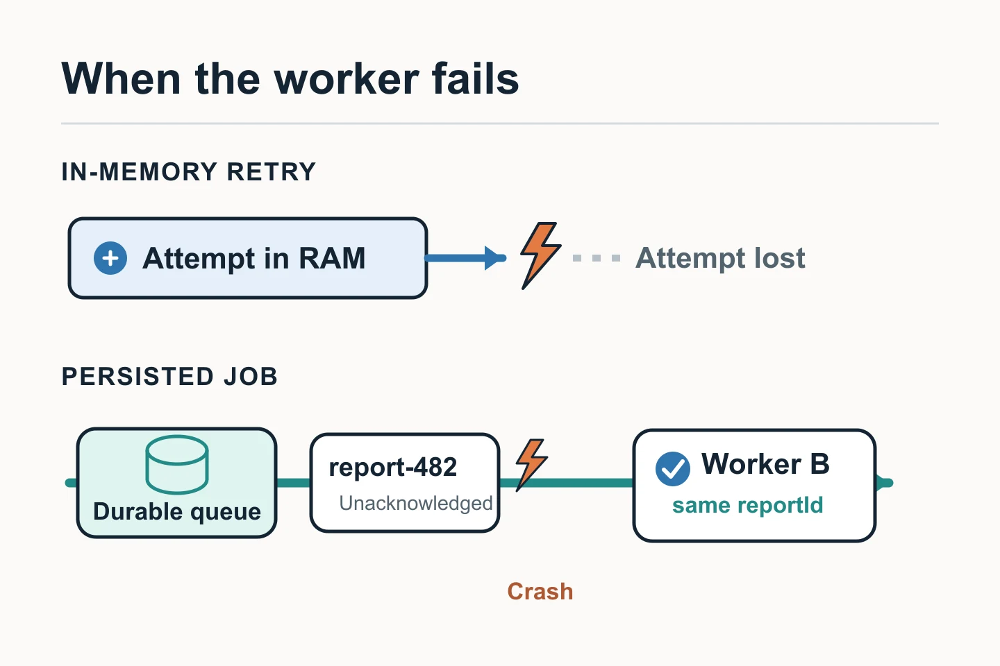

An asynchronous task lets an API accept a request and finish the work later. Retrying it requires deciding **how long it may wait** and **what happens if the process disappears**. An in-memory loop and a persisted job answer different needs.

## A timeout does not reveal whether the operation finished

An API accepts a request to generate a report, and a worker uploads it to external storage. The upload may time out. Sometimes a few seconds are enough to recover; at other times the provider is down for minutes. A timeout also does not confirm whether the file arrived: it may have been saved even if the response never returned.

## Brief retries inside the worker

A short transient failure may justify a **bounded** number of attempts inside the worker, with [increasing delays and some variation](https://docs.aws.amazon.com/wellarchitected/latest/framework/rel_mitigate_interaction_failure_limit_retries.html) between attempts. There must also be an overall time limit: multiplying attempts across the API, worker, and SDK can turn three retries per layer into many provider calls. A credentials or format error will not be fixed by repeating the same call.

## When the job must survive the process

If the operation must continue after a restart or a long outage, it goes into a durable queue or task store **before** the API responds that it has been accepted. The worker [acknowledges it](https://www.rabbitmq.com/docs/reliability) after completing the work; if it dies first, the job may be delivered again. Durable delivery protects the job, but means accepting that the same job may run more than once.

The report needs a stable `reportId` and a storage key derived from it. If the first upload succeeded but the response was lost, the next attempt must recognize the same result or overwrite it safely; generating a new key would create duplicates. Idempotency must also cover later state changes or notifications: an idempotent upload alone does not protect those effects.

## The operational decision

A durable retry adds a queue, state, monitoring, and a policy for jobs that exhaust their attempts. Recording each attempt and its cause helps distinguish a temporary incident from one that needs intervention. It makes sense when losing the job with the process would be worse than maintaining that infrastructure; for a short, safe call, a bounded in-memory retry may be enough.
