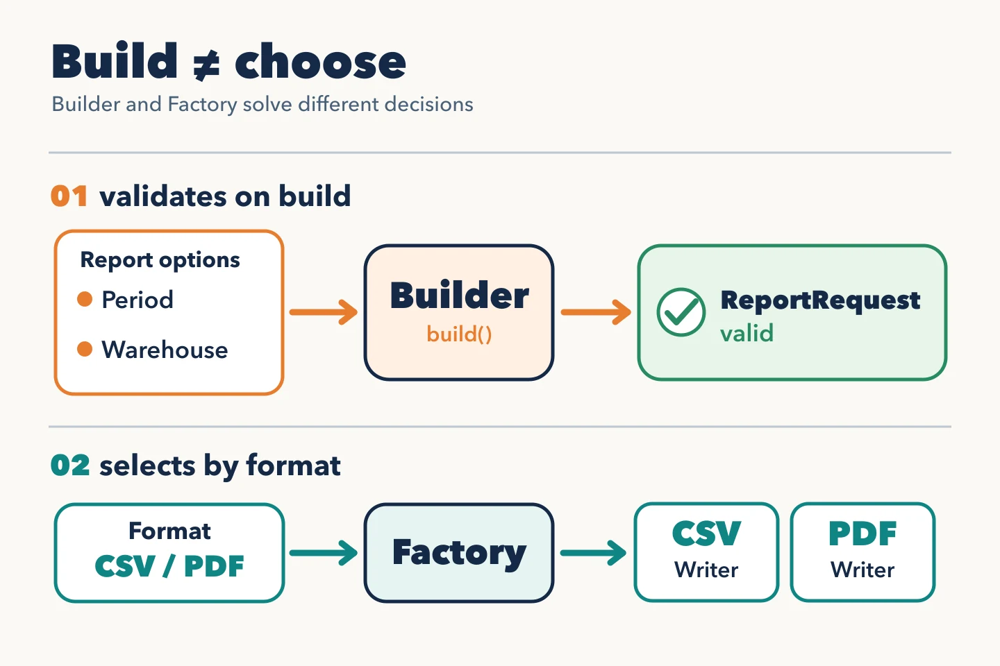

Creating an object also involves decisions: what data it needs to be valid and which implementation fits each situation. **Builder** and **Factory** help at different points in that process.

## Builder: construct a valid request

An inventory report accepts a date range, a warehouse, and an option to include out-of-stock products. A constructor with several positional parameters makes it easy to swap dates or leave a request incomplete.

`ReportRequestBuilder` names each option and validates the whole request on `build()`: a required date range, a start date before the end date, and a default for including out-of-stock products. The result is a valid `ReportRequest`; the use case does not need to know how it was assembled. The builder does not replace validation of external input: it turns that input into a value that satisfies its invariants.

## Factory: choose the writer

The same report can be exported as CSV or PDF. Both the endpoint and a scheduled job need to choose a writer from the format of **each request**. `createReportWriter(format)` keeps that choice in one place: it creates `CsvReportWriter` or `PdfReportWriter`, both behind the same writing contract. A small function is enough; there is no need to create a class just to call it a Factory. An unknown format should produce an explicit error; silently choosing CSV would generate an unexpected report.

## When each one earns its place

Builder answers “how do I build this request without leaving it half configured?” Factory answers “which writer matches this format?” They are independent solutions: one may be useful without the other. With two straightforward fields, a constructor or creation function is enough; with one writer, there is no choice to centralize. The pattern's name matters less than the decision it makes visible.
