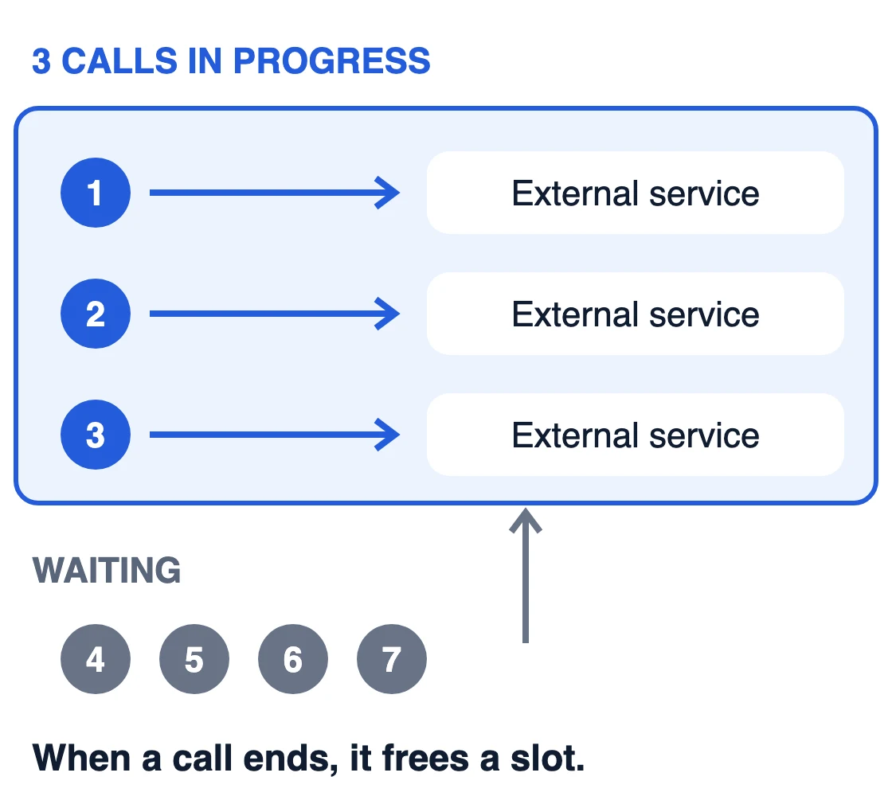
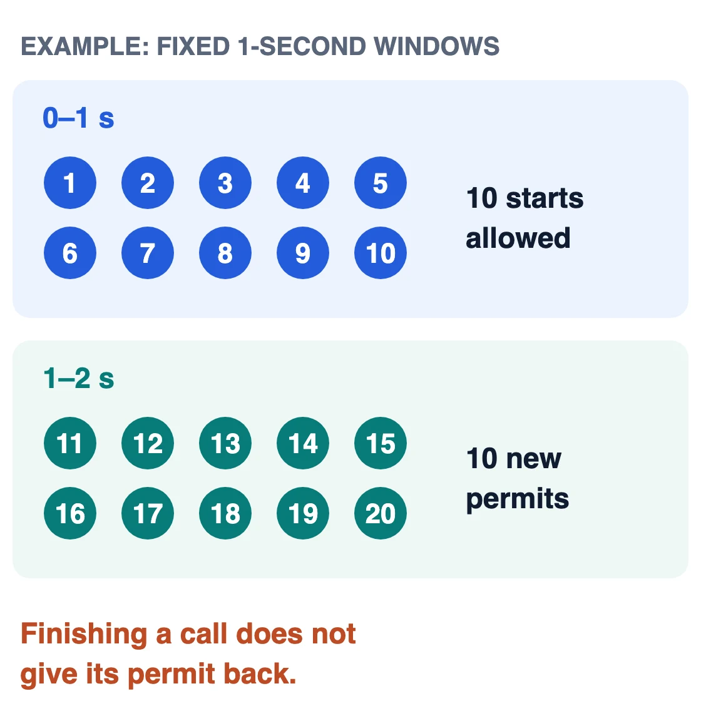
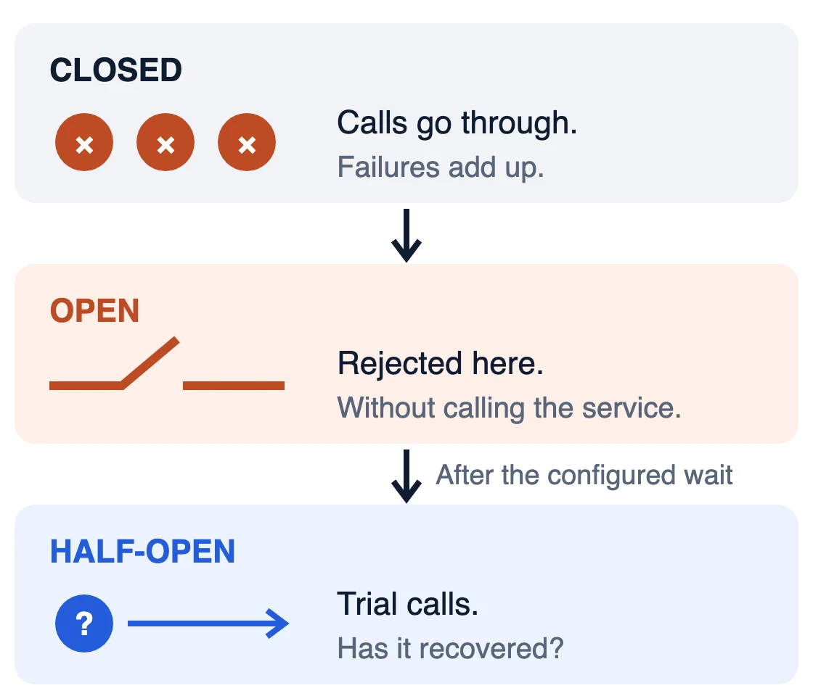
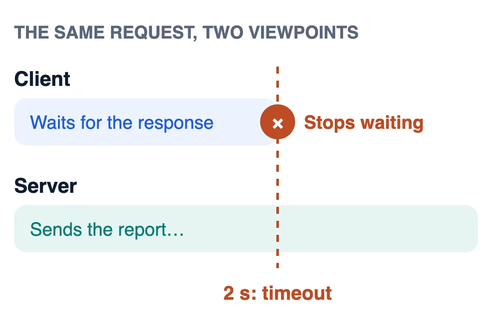

**Resilience** is an application's ability to keep working in a controlled way when something it depends on fails. The failure does not go away: what you decide is how far it reaches.

## Example: sending reports through a provider

Imagine an application that generates reports and calls an external provider to send them. The provider may pile up slow calls, enforce a quota, fail repeatedly or stop responding. Each situation has its mechanism; the values are examples.

### Semaphore / bulkhead

A semaphore with three permits allows three calls in progress; the rest wait or are rejected. The bulkhead is the pattern that uses this idea to isolate each dependency's resources. The permit is released when the call ends or fails, and the limit applies per instance.

### Rate limiter

If the provider accepts ten requests per second, the limiter spreads the hundred sends over time. Finishing a call does not give the permit back: if each send takes three seconds, by the third second thirty are in progress, and the number grows if the provider slows down. To bound them, combine it with a semaphore. If requests wait, that queue needs a limit too.

Some HTTP clients already cap their connections with their own pool; check its configuration before adding another limit.

### Circuit breaker

When failures cross the configured threshold, the circuit opens and rejects calls without waiting for the provider. After a while, a few trial calls check whether it has recovered.

### Timeout

A two-second deadline bounds how long the application waits. The provider may keep working and send the report anyway; that is why duplicates must be prevented before a [retry](/en/pills/diseno-de-sistemas/asincronia-reintentos/).

In Java, [Resilience4j](https://resilience4j.readme.io/docs/getting-started) is one example of a library that implements all four; the limits and what to do with each failure remain the application's decisions.

## What being resilient means here

Each mechanism bounds part of the impact (resources, pace, insistence and waiting) in exchange for limits to tune and states to observe. None of them decides what happens to the report that was not sent: keep it as pending, report the failure or retry it safely.
