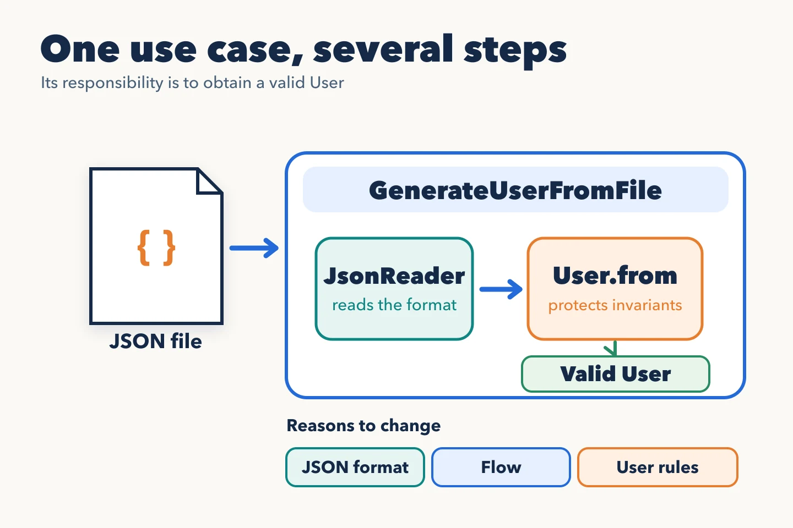

The Single Responsibility Principle (SRP) helps decide which code belongs together according to its [reason to change](https://blog.cleancoder.com/uncle-bob/2014/05/08/SingleReponsibilityPrinciple.html). Counting methods or verbs does not reveal that boundary: a use case can have one responsibility and still need several steps to fulfill it.

## One operation, several steps

An asynchronous process receives a JSON file containing a user's data. Before saving it, the process needs a valid `User`. It must read the file, check its expected shape, and build the user. Are those three responsibilities of the use case?

`GenerateUserFromFile` is responsible for a complete operation: obtain a valid user or explain why that was impossible. It may coordinate collaborators with different knowledge. The reader interprets JSON; `User.from` checks the user's invariants as it builds one.

In code, the coordination can look like this:

~~~ts
class GenerateUserFromFile {
  constructor(private readonly reader: JsonReader) {}

  public execute(file: UserFile): User {
    const data = this.reader.read(file);
    return User.from(data);
  }
}
~~~

If the JSON cannot be read or data required by `User.from` is missing, no user is built. The outer process decides what to do with the error and when to save the user. Persistence is a separate decision from construction.

## Where to split and where to keep things together

The JSON format and the rules that make a `User` valid can evolve for different reasons. That is a useful boundary if the reader is reused or has complexity of its own. Splitting `read`, `validateFormat`, and `toUser` into classes merely because they are three steps, however, makes the flow harder to follow without isolating a real change.

The example uses a `JsonReader` to show that boundary, but an initial implementation can keep reading as a private method if it only serves this flow. A separate creation policy may also make sense when its rules change for a reason of their own; then it must be clear what the policy checks and which invariants `User.from` protects, without duplicating the same rule. **A responsibility is defined by the decision it protects, not by the number of calls it coordinates.**
