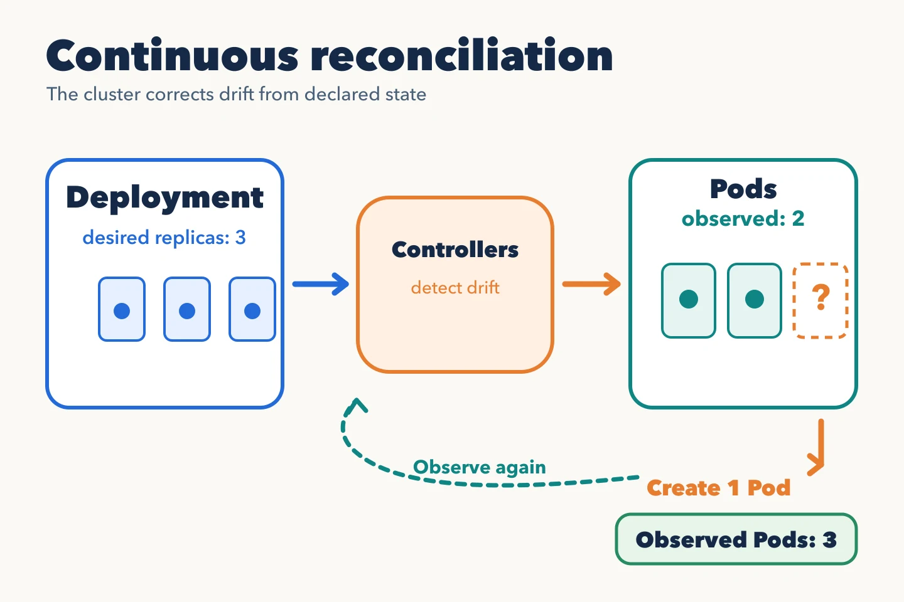

A manifest represents a Kubernetes API object, usually as YAML. It expresses
**intent**, not a sequence of commands run once. This example is schematic:
before applying it, create the `inventory` namespace and replace the digest
with one from an image published to a registry the cluster can reach.

```yaml
apiVersion: apps/v1
kind: Deployment
metadata:
  name: inventory-api
  namespace: inventory
spec:
  replicas: 3
  selector:
    matchLabels:
      app: inventory-api
  template:
    metadata:
      labels:
        app: inventory-api
    spec:
      containers:
        - name: api
          image: registry.example.com/inventory-api@sha256:<digest>
          ports:
            - containerPort: 8080
```

`apiVersion` and `kind` identify the object type; `metadata` identifies it
within a namespace; `spec` describes what we want. Here, the Deployment's
selector must match the Pod template labels. The API rejects a Deployment
whose selector does not match. An `apps/v1` Deployment selector also cannot
be changed after creation.

## Declaring is not executing

When you apply the file, the API server stores the intent. The Deployment
controller creates a ReplicaSet, which creates Pods. The scheduler places
them, and each node's kubelet tries to start their containers. `status`
reflects what was observed. It may take time to match `spec`, or never
match it: an image pull error, insufficient capacity or a probe that never
succeeds can block the expected state.



```bash
kubectl apply -f deployment.yaml
kubectl -n inventory get deployment inventory-api
kubectl -n inventory rollout status deployment/inventory-api
```

These commands assume the corrected manifest was saved as `deployment.yaml`.
`apply` confirms the change was accepted; `rollout status` waits for rollout
progress. Even a completed rollout does not prove every business endpoint
works. That needs application tests and signals.

The versioned file lets people review intent. A manual change in the cluster
can make live state diverge from Git. We will see how GitOps detects and
corrects that drift.

The [Kubernetes object documentation](https://kubernetes.io/docs/concepts/overview/working-with-objects/)
explains the distinction between `spec` and `status`.
