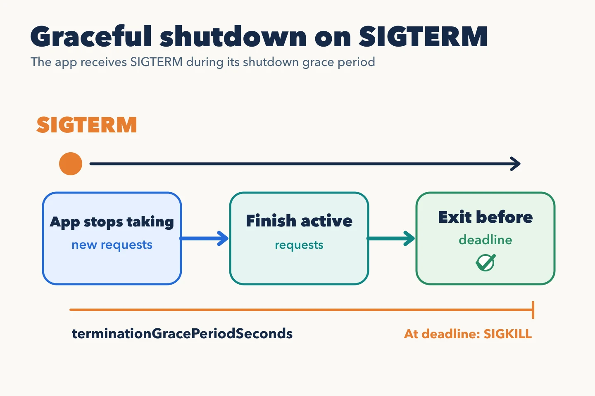

A **Pod** is the unit Kubernetes assigns to a node. It contains one or more
containers that share networking and some volumes. For the inventory API,
one main container per Pod is typical. Multiple containers make sense when
they must cooperate closely through the same lifecycle.

Each Pod has its own IP, and its containers can communicate over
`localhost`. That IP is not the application's stable address. A replacement
Pod has a new identity and usually another IP; a Service will bridge that
change.

## From pending Pod to process

The scheduler selects a node for an unassigned Pod. It considers requested
resources and placement constraints, among other things. The node's kubelet
pulls the image, prepares volumes and networking, starts containers and
reports their state. A Pod may be in phase `Pending`, `Running`, `Succeeded`
or `Failed`. Messages such as `CrashLoopBackOff` are reasons or statuses
shown by tools, not Pod phases.

`Running` means the Pod is bound to a node and at least one container is
running or starting. It does not mean the API can handle requests. Whether
it is available for traffic depends on a readiness probe, covered later.

## Termination is part of the design

When a Pod is replaced, Kubernetes starts termination with a grace period
(30 seconds by default). In the usual Linux container case, the main process
receives `SIGTERM` unless another stop signal was configured. The application
should handle it: stop taking
new work, finish in-flight requests and close connections. After the grace
period, the runtime may stop it by force. An application that ignores this
sequence can lose work even when the Deployment appears healthy.

Pods are replaceable. Keep durable data outside their ephemeral filesystem
or in persistent storage designed for that purpose. A Deployment creates
equivalent Pods, but it cannot by itself guarantee transactions or shared
state correctness.

The [Pod lifecycle documentation](https://kubernetes.io/docs/concepts/workloads/pods/pod-lifecycle/)
details phases and the termination sequence.
