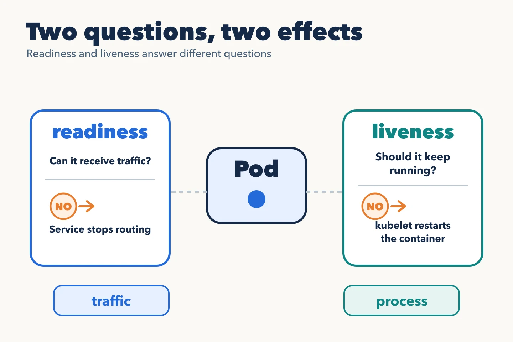

An API process can be alive but unable to answer requests. Probes let you
express three different questions to the kubelet:

- **Startup:** has startup finished? Until it succeeds, liveness and
  readiness checks are delayed.
- **Readiness:** can it receive traffic now? When this fails, the Pod stops
  being a normal destination of Services that select it, but its container
  keeps running.
- **Liveness:** is it stuck in a state that a restart would fix? Repeated
  failure causes the kubelet to restart the container.



The paths in the following snippet are illustrative: the application must
implement them, with responses that match each question.

```yaml
startupProbe:
  httpGet: { path: /health/startup, port: 8080 }
  periodSeconds: 5
  failureThreshold: 24
readinessProbe:
  httpGet: { path: /health/ready, port: 8080 }
  periodSeconds: 5
  failureThreshold: 2
livenessProbe:
  httpGet: { path: /health/live, port: 8080 }
  periodSeconds: 10
  failureThreshold: 3
```

This example allows roughly two minutes for startup before treating it as
failed. Set real thresholds from measured application behaviour. A readiness
check that queries the database can help if no request works without it. A
liveness check tied to that same database can turn an external outage into
a wave of restarts.

## Match the check to its question

`/health/live` might check that the process responds and its main loop is
not blocked. `/health/ready` might require critical components to be
initialized and able to serve their contract. Avoid letting an optional
dependency remove an otherwise useful application from the Service.

During shutdown, readiness and Pod termination help remove the replica
from new traffic. That change does not propagate instantaneously: the
application must handle termination and have enough grace time to finish
in-flight requests. Correct probes do not replace correct shutdown.

The official [probe documentation](https://kubernetes.io/docs/concepts/configuration/liveness-readiness-startup-probes/)
explains their behaviour and effects.
