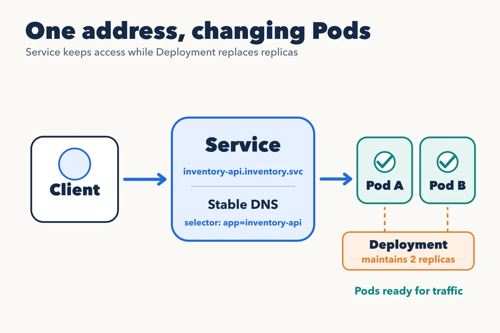

`inventory-api` Pods are replaced during deployment or after a node
failure. Their IPs are not a useful contract for another application. A
**Service** provides a stable address and selects the Pods that can serve it.



```yaml
apiVersion: v1
kind: Service
metadata:
  name: inventory-api
  namespace: inventory
spec:
  type: ClusterIP
  selector:
    app: inventory-api
  ports:
    - name: http
      port: 80
      targetPort: 8080
```

A client in the same namespace can call
`http://inventory-api:80/items`. In another namespace, it can use
`inventory-api.inventory.svc.cluster.local`. DNS resolves the Service name;
it does not hand the client a list of Pods to choose from. The cluster's
networking implementation routes the connection to an eligible backend.

The `app: inventory-api` selector must match the Pod labels. Kubernetes
maintains **EndpointSlices** containing Service destinations and their
conditions. If a Service exists but has no ready endpoints, checking labels
and readiness is usually more useful than looking for a DNS problem.

```bash
kubectl -n inventory get service inventory-api
kubectl -n inventory get endpointslice -l kubernetes.io/service-name=inventory-api
kubectl -n inventory get pods -l app=inventory-api
```

A `ClusterIP` Service provides connectivity inside the cluster. It does not
publish the API to the Internet on its own. Nor does it guarantee session
affinity or safe retries: a connection may break as a Pod is replaced. The
client needs timeouts and a retry policy aligned with the idempotency of
each operation.

The [Service](https://kubernetes.io/docs/concepts/services-networking/service/)
and [EndpointSlice](https://kubernetes.io/docs/concepts/services-networking/endpoint-slices/)
documentation describes how destinations are discovered and updated.
