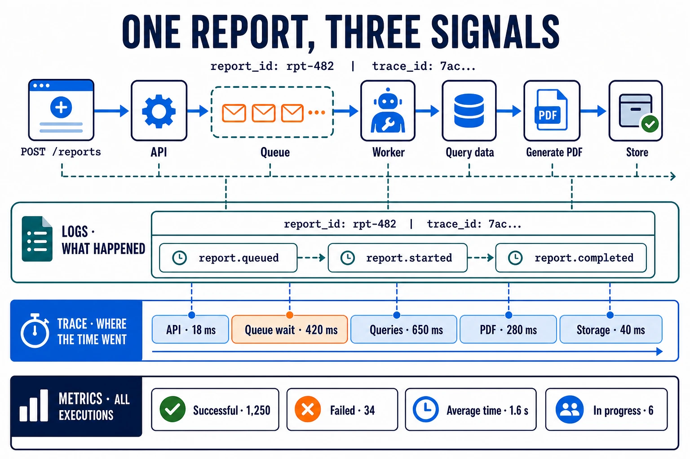

Observability is the ability to **understand what is happening inside a system
from the information it produces**. It lets you know its state, detect problems
and investigate why it behaves in a particular way.

## How it works

An observable application produces three main signals:

- **Logs:** record specific events, such as a report being queued or completed.
- **Metrics:** aggregate measurements over time, such as successful reports,
  failed reports or average generation time.
- **Traces:** show a report's journey from the request to the stored file and
  how long each step took.

The three signals complement each other. A metric shows that generation time
has increased, a trace reveals whether the wait happened in the queue or during
a query, and the logs explain what happened to that report. Together they let
you move from detecting a symptom to finding its cause.

## In distributed systems

In a simple application, all three signals come from the same process: you can
collect its logs, query its metrics and follow the generation without crossing
several services. In the example, the request crosses an API, a queue, a worker
and the data sources; each component produces its own part of the information.

To observe the complete journey, you need to centralize the signals and
propagate shared context. The `report_id` identifies the report, while the
`trace_id` connects its execution across services. Including both in the logs
lets you relate them to the trace, even when they were produced by different
processes or machines.
