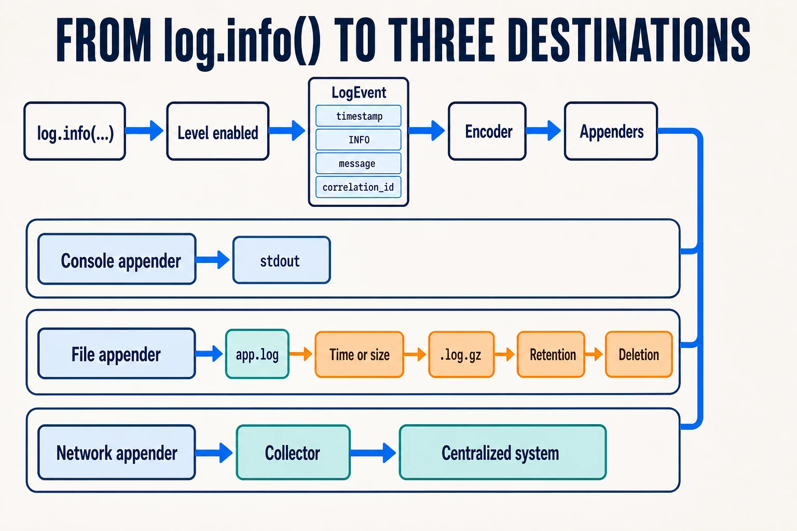

A call such as `log.info(...)` looks simple, but it may write to the console, a
file or even send data over the network. Between the code and the destination,
a pipeline filters, builds and distributes each event.

## What happens when you log

The general path is:

```text
log.info(...) → check level → build event → filter
              → encode → send to one or more appenders
```

If the level is disabled, the call is discarded. If it is enabled, the logger
creates an event with the message, context and metadata; the encoder serializes
it and the **appenders** send it to their destinations.

A synchronous appender writes from the current thread. An asynchronous one uses
a queue, but when it fills up, it must block the application or discard logs.

## How it reaches different destinations



An appender decides where each event ends up:

- **Console:** writes to `stdout` or `stderr`.
- **File:** stores logs on disk and applies rotation policies.
- **Network:** sends them through protocols such as Syslog or GELF. Writing to a
  database is also possible, although it is rarely the first choice.
- **Multiple destinations:** each adds serialization, input/output and its own
  failure mode. A disk can fill up and a network connection can block.

Logback is one implementation that lets you declare this pipeline in
`logback-spring.xml`:

```xml
<configuration>
  <appender name="STDOUT" class="ch.qos.logback.core.ConsoleAppender">
    <encoder>
      <pattern>%d %-5level [%X{correlation_id}] %logger - %msg%n</pattern>
    </encoder>
  </appender>

  <appender name="FILE" class="ch.qos.logback.core.rolling.RollingFileAppender">
    <file>logs/app.log</file>
    <rollingPolicy class="ch.qos.logback.core.rolling.SizeAndTimeBasedRollingPolicy">
      <fileNamePattern>logs/app.%d{yyyy-MM-dd}.%i.log.gz</fileNamePattern>
      <maxFileSize>100MB</maxFileSize>
      <maxHistory>14</maxHistory>
      <totalSizeCap>2GB</totalSizeCap>
    </rollingPolicy>
    <encoder>
      <pattern>%d %-5level [%X{correlation_id}] %logger - %msg%n</pattern>
    </encoder>
  </appender>

  <root level="INFO">
    <appender-ref ref="STDOUT" />
    <appender-ref ref="FILE" />
  </root>
</configuration>
```

In this example, the active file is `logs/app.log`. It is archived every day or
after exceeding `100MB`, rotated files are compressed as `.log.gz`, and they are
kept for `14` days without exceeding `2GB` in total. These values are only
examples and must be adjusted to the log volume and available space. Rotation,
compression, retention and the total size cap protect the disk; without these
policies, logs can degrade or stop the server when storage runs out.

Sending logs directly over the network couples the application to the external
system. It is therefore common to write to `stdout` or a file and let a collector
forward them to a centralized system such as Graylog or Loki.

Centralizing logs solves where to search, but not how to know which events
belong to the same operation. That requires a shared identifier.

## How logs are correlated

The **MDC** (*Mapped Diagnostic Context*) is a key-value map associated with the
current context. It can store a `correlation_id` and automatically add it to
each event through `%X{correlation_id}`:

```java
MDC.put("correlation_id", correlationId);
try {
  log.info("Report generation started report_id={}", reportId);
  generateReport(reportId);
} finally {
  MDC.remove("correlation_id");
}
```

The `finally` block prevents a reused thread from mixing requests. If the
operation continues over HTTP, a queue or an asynchronous thread, the
`correlation_id` must be propagated and installed again: MDC does not cross
those boundaries automatically.

The `report_id` identifies the report; the `correlation_id`, the complete
operation; and the `trace_id`, one traced execution.
