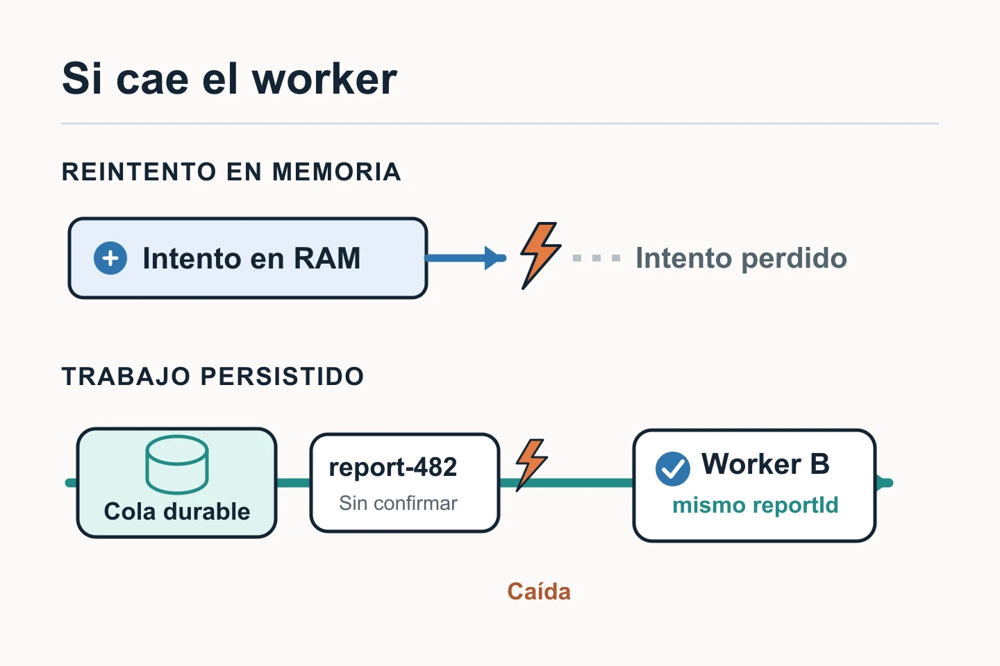

Una tarea asíncrona permite aceptar una petición y terminar el trabajo después. Reintentarla exige decidir **cuánto tiempo puede esperar** y **qué ocurre si el proceso desaparece**. Un bucle en memoria y un trabajo persistido responden a necesidades distintas.

## El timeout no dice si la operación terminó

Una API acepta la generación de un informe y un worker lo sube a un almacenamiento externo. La subida puede devolver un timeout. A veces bastan unos segundos para recuperarse; otras veces el proveedor está caído durante minutos. Además, un timeout no confirma si el fichero llegó: pudo guardarse aunque la respuesta no volviera.

## Reintentos breves dentro del worker

Un fallo transitorio corto admite un número **acotado** de reintentos dentro del worker, con [espera creciente y algo de variación](https://docs.aws.amazon.com/wellarchitected/latest/framework/rel_mitigate_interaction_failure_limit_retries.html) entre intentos. Hace falta un límite total de tiempo: multiplicar los intentos de la API, el worker y el SDK puede convertir tres reintentos por capa en muchas llamadas al proveedor. Un error de credenciales o de formato no se arregla repitiendo la misma llamada.

## Cuando el trabajo debe sobrevivir al proceso

Si la operación debe continuar tras un reinicio o una caída larga, se guarda en una cola o almacén de tareas duradero **antes** de responder que ha sido aceptada. El worker [confirma el trabajo](https://www.rabbitmq.com/docs/reliability) después de completarlo; si cae antes, puede entregarse de nuevo. La entrega duradera protege el trabajo, pero implica aceptar que el mismo trabajo puede ejecutarse más de una vez.

El informe necesita un `reportId` estable y una clave de almacenamiento derivada de él. Si la primera subida tuvo éxito pero se perdió la respuesta, el siguiente intento debe detectar que es el mismo resultado o sobrescribirlo de forma segura; generar una clave nueva crearía duplicados. La idempotencia debe abarcar también cualquier cambio de estado o notificación posterior: una subida idempotente no protege esos efectos por sí sola.

## La decisión operativa

Un reintento duradero añade cola, estado, supervisión y una política para trabajos que agotan sus intentos. Registrar cada intento y su causa ayuda a distinguir una incidencia temporal de uno que requiere intervención. Se justifica cuando perder el trabajo al morir el proceso sería peor que mantener esa infraestructura; para una llamada corta y segura, el reintento acotado en memoria puede ser suficiente.
