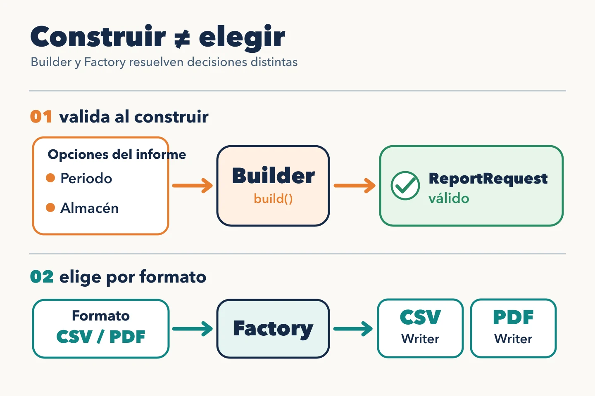

Crear un objeto también implica tomar decisiones: qué datos necesita para ser válido y qué implementación corresponde a cada situación. **Builder** y **Factory** ayudan en momentos distintos de esa creación.

## Builder: construir una petición válida

Un informe de inventario admite periodo, almacén y la opción de incluir productos agotados. Un constructor con varios parámetros posicionales permite intercambiar las fechas sin darse cuenta o dejar la petición a medias.

`ReportRequestBuilder` da nombre a cada opción y valida el conjunto al llamar a `build()`: periodo obligatorio, fecha inicial anterior a la final y valor por defecto para incluir agotados. El resultado es un `ReportRequest` válido; el caso de uso no necesita conocer los pasos usados para montarlo. El *builder* no sustituye la validación de datos externos: transforma esos datos en un valor que ya cumple sus invariantes.

## Factory: elegir el escritor

El mismo informe puede salir en CSV o PDF. Tanto el endpoint como un proceso programado necesitan escoger el escritor según el formato de **cada petición**. `createReportWriter(format)` concentra esa elección: crea `CsvReportWriter` o `PdfReportWriter`, ambos bajo el mismo contrato de escritura. Puede ser una función pequeña; no hace falta crear una clase por llamarla Factory. Si llega un formato desconocido, debe devolver un error explícito; elegir CSV por defecto produciría un informe inesperado.

## Cuándo compensa cada uno

Builder responde «¿cómo construyo esta petición sin dejarla a medias?». Factory responde «¿qué escritor corresponde a este formato?». Son soluciones independientes: se puede necesitar una sin la otra. Con dos campos claros, un constructor o una función de creación bastan; con un solo escritor, no hay selección que centralizar. El nombre del patrón importa menos que la decisión concreta que deja visible.
