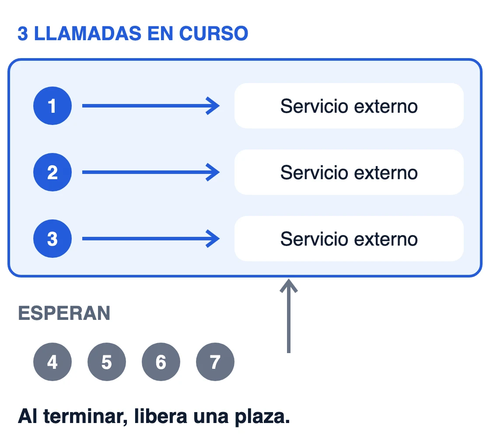
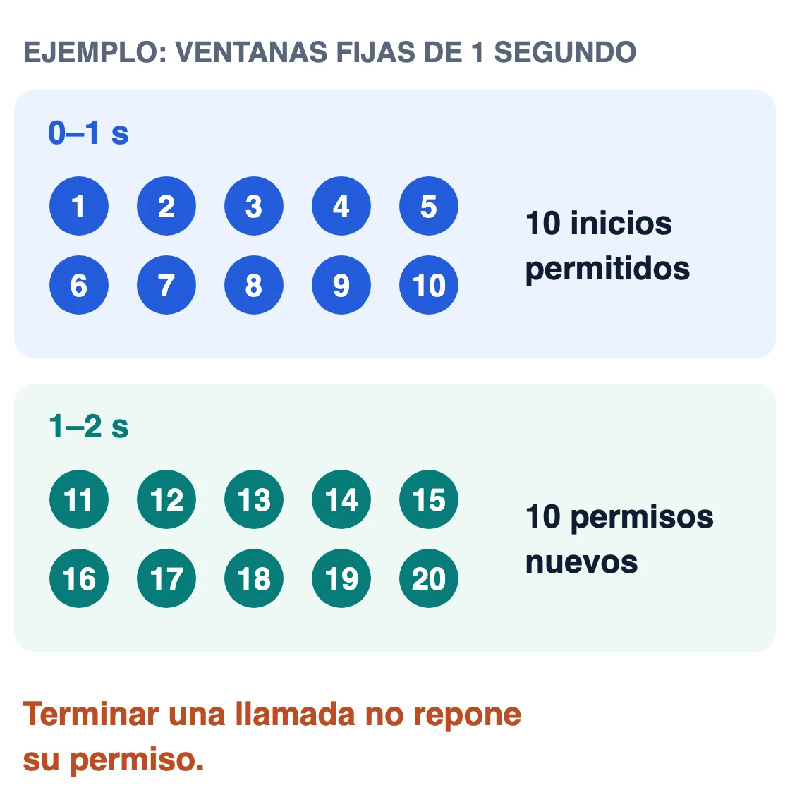
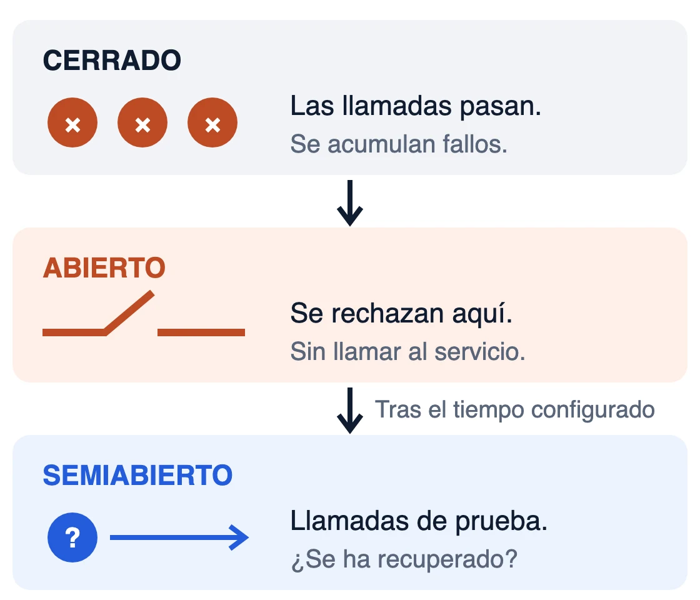
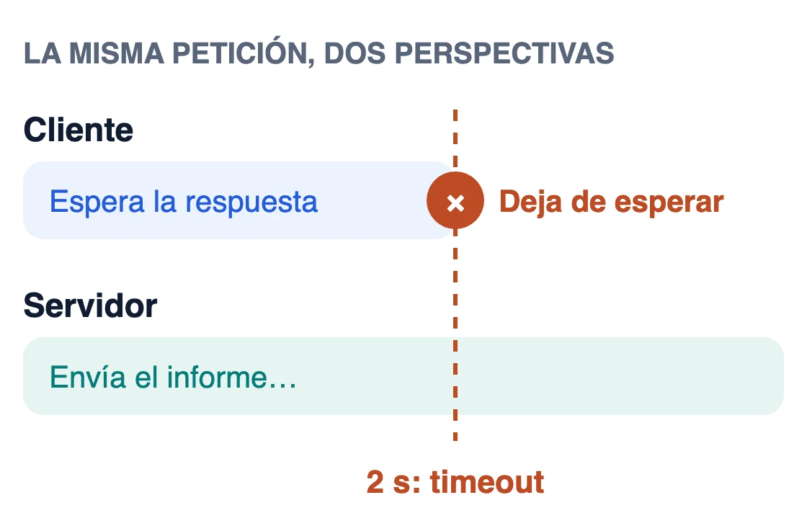

La **resiliencia** es la capacidad de una aplicación de seguir funcionando de forma controlada cuando falla algo de lo que depende. El fallo no desaparece: lo que se decide es hasta dónde llega.

## Ejemplo: enviar informes a través de un proveedor

Imaginemos una aplicación que genera informes y llama a un proveedor externo para enviarlos. El proveedor puede acumular llamadas lentas, imponer una cuota, fallar seguido o dejar de responder. Cada situación tiene su mecanismo; los valores son de ejemplo.

### Semáforo / bulkhead

Un semáforo con tres permisos deja tres llamadas en curso; el resto espera o se rechaza. El bulkhead es el patrón que usa esa idea para aislar los recursos de cada dependencia. El permiso se libera al terminar o fallar, y el límite es por instancia.

### Rate limiter

Si el proveedor admite diez peticiones por segundo, el limitador reparte los cien envíos en el tiempo. Terminar una llamada no devuelve el permiso: si cada envío tarda tres segundos, en el tercero hay treinta en curso, y el número crece si el proveedor va más lento. Para acotarlas, se combina con un semáforo. Si las peticiones esperan, esa cola también necesita un límite.

Algunos clientes HTTP ya limitan sus conexiones con un pool propio; conviene revisar su configuración antes de añadir otro límite.

### Circuit breaker

Cuando los fallos superan el umbral configurado, el circuito se abre y rechaza las llamadas sin esperar al proveedor. Pasado un tiempo, unas llamadas de prueba comprueban si se ha recuperado.

### Timeout

Un plazo de dos segundos acota cuánto espera la aplicación. El proveedor puede seguir trabajando y enviar el informe igualmente; por eso, antes de [reintentar](/pildoras/diseno-de-sistemas/asincronia-reintentos/), hay que evitar duplicados.

En Java, [Resilience4j](https://resilience4j.readme.io/docs/getting-started) es un ejemplo de librería que implementa los cuatro; los límites y qué hacer con cada fallo siguen siendo decisiones de la aplicación.

## Qué significa ser resiliente aquí

Cada mecanismo acota una parte del impacto (los recursos, el ritmo, la insistencia y la espera) a cambio de límites que ajustar y estados que observar. Ninguno decide qué pasa con el informe que no se envió: guardarlo como pendiente, informar del fallo o reintentarlo con seguridad.
