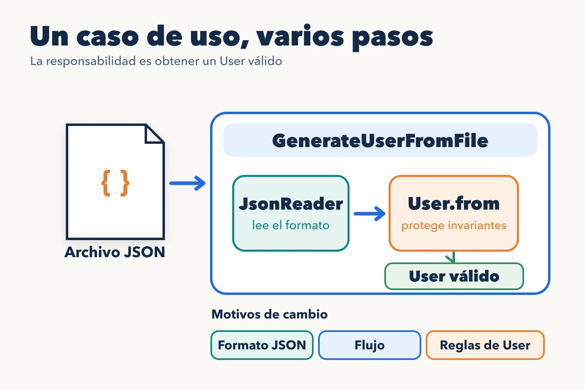

El Principio de Responsabilidad Única (SRP) ayuda a decidir qué código conviene mantener junto según su [motivo de cambio](https://blog.cleancoder.com/uncle-bob/2014/05/08/SingleReponsibilityPrinciple.html). Contar métodos o verbos no revela esa frontera: un caso de uso puede tener una sola responsabilidad y necesitar varios pasos para cumplirla.

## Una operación con varios pasos

Un proceso asíncrono recibe un fichero JSON con los datos de un usuario. Antes de guardarlo necesita obtener un `User` válido. Hay que leer el fichero, comprobar si tiene la forma esperada y construir el usuario. ¿Son tres responsabilidades del caso de uso?

`GenerateUserFromFile` responde por una operación completa: obtener un usuario válido o explicar por qué no se pudo. Puede coordinar colaboradores con conocimientos distintos. El lector interpreta JSON; `User.from` comprueba las invariantes del usuario al construirlo.

En código, la coordinación puede ser así:

~~~ts
class GenerateUserFromFile {
  constructor(private readonly reader: JsonReader) {}

  public execute(file: UserFile): User {
    const data = this.reader.read(file);
    return User.from(data);
  }
}
~~~

Si el JSON no se puede leer o faltan datos exigidos por `User.from`, no se construye el usuario. El proceso exterior decide qué hacer con ese error y cuándo guardarlo. Esa decisión de persistencia no forma parte de la construcción.

## Dónde separar y dónde mantener junto

El formato JSON y las reglas que hacen válido a `User` pueden evolucionar por motivos distintos. Esa es una frontera útil si el lector se reutiliza o tiene complejidad propia. En cambio, separar `read`, `validateFormat` y `toUser` en clases por ser tres pasos obliga a recorrer más piezas sin aislar un cambio real.

El ejemplo usa un `JsonReader` para mostrar la frontera, pero una implementación inicial puede mantener la lectura como método privado si solo sirve a este flujo. También puede existir una política de creación separada cuando sus reglas cambian por una razón propia; en ese caso hay que definir qué valida la política y qué invariantes conserva `User.from`, sin duplicar la misma regla en ambos sitios. **Una responsabilidad se reconoce por la decisión que protege, no por el número de llamadas que coordina.**
