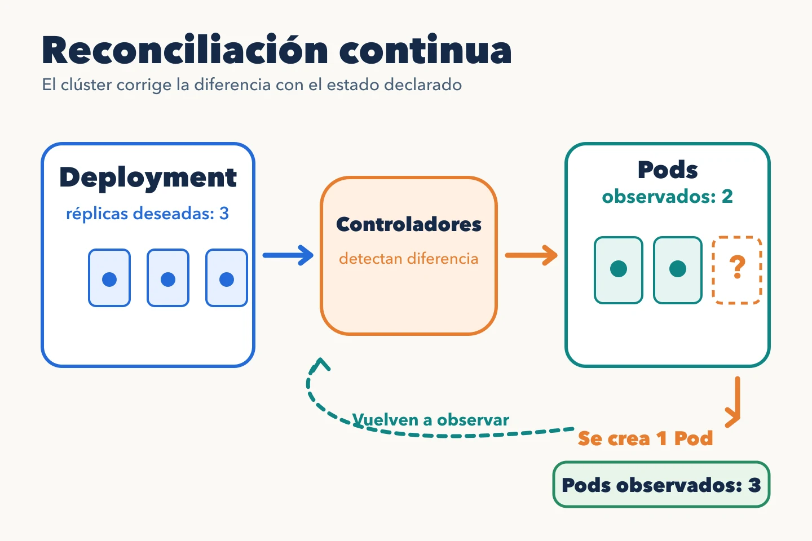

Un manifiesto es una representación de un objeto de la API de Kubernetes,
normalmente en YAML. Describe la **intención**, no una secuencia de comandos
que se ejecuta una sola vez. Este ejemplo es esquemático: antes de aplicarlo
hay que crear el namespace `inventory` y sustituir el digest por el de una
imagen publicada y accesible desde el clúster.

```yaml
apiVersion: apps/v1
kind: Deployment
metadata:
  name: inventory-api
  namespace: inventory
spec:
  replicas: 3
  selector:
    matchLabels:
      app: inventory-api
  template:
    metadata:
      labels:
        app: inventory-api
    spec:
      containers:
        - name: api
          image: registry.example.com/inventory-api@sha256:<digest>
          ports:
            - containerPort: 8080
```

`apiVersion` y `kind` dicen qué objeto es; `metadata` lo identifica dentro
del namespace; `spec` expresa lo que queremos. En este caso, el selector del
Deployment debe coincidir con las etiquetas de la plantilla de Pods. Un
selector que no coincida hace que la API rechace el Deployment. Además, el
selector de un Deployment `apps/v1` no se puede cambiar después de crearlo.

## Declarar no equivale a ejecutar

Al aplicar el fichero, el API server guarda la intención. El controlador del
Deployment crea un ReplicaSet, este crea los Pods, el scheduler les asigna
un nodo y el kubelet intenta arrancar sus contenedores. `status` refleja lo
observado; puede tardar en coincidir con `spec` o no llegar a hacerlo. Un
fallo al descargar la imagen, falta de capacidad o una probe que nunca pasa
impiden alcanzar el estado esperado.



```bash
kubectl apply -f deployment.yaml
kubectl -n inventory get deployment inventory-api
kubectl -n inventory rollout status deployment/inventory-api
```

Estos comandos presuponen que el manifiesto corregido se guardó como
`deployment.yaml`. `apply` confirma la aceptación del cambio; `rollout status` espera el avance
del despliegue. Ni siquiera un rollout correcto prueba que todas las rutas de
negocio funcionen. Eso requiere pruebas y señales propias de la aplicación.

El fichero versionado permite revisar la intención. Si alguien cambia el
objeto a mano en el clúster, el estado vivo puede separarse de Git; más
adelante veremos cómo GitOps detecta y corrige esa deriva.

La [documentación de objetos de Kubernetes](https://kubernetes.io/docs/concepts/overview/working-with-objects/)
explica la distinción entre `spec` y `status`.
