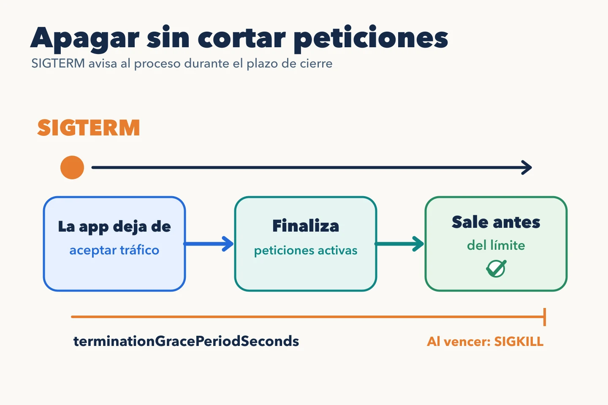

El **Pod** es la unidad que Kubernetes asigna a un nodo. Contiene uno o varios
contenedores que comparten red y ciertos volúmenes. Para la API de inventario,
lo normal es un contenedor principal por Pod; varios contenedores tienen
sentido cuando deben cooperar estrechamente durante el mismo ciclo de vida.

Cada Pod tiene su propia IP y sus contenedores pueden comunicarse por
`localhost`. Esa IP no es la dirección estable de la aplicación: si el Pod
se sustituye, el nuevo recibe otra identidad y normalmente otra IP. Un
Service resolverá ese cambio.

## Del Pod pendiente al proceso

El scheduler elige un nodo para un Pod sin asignar. Considera, entre otras
cosas, los recursos solicitados y las restricciones de ubicación. El kubelet
del nodo descarga la imagen, prepara volúmenes y red, arranca contenedores y
comunica su estado. Un Pod puede estar en fase `Pending`, `Running`,
`Succeeded` o `Failed`; mensajes como `CrashLoopBackOff` son motivos o
estados mostrados por herramientas, no fases del Pod.

`Running` indica que el Pod está ligado a un nodo y al menos un contenedor
está funcionando o arrancando. No implica que la API atienda peticiones. La
condición de disponibilidad para recibir tráfico depende de la readiness
probe, que veremos más adelante.

## Terminar también es parte del diseño

Al sustituir un Pod, Kubernetes inicia una terminación con un plazo de gracia
(por defecto, 30 segundos). En el caso habitual de contenedores Linux, el
proceso principal recibe `SIGTERM`, salvo que se haya configurado otra señal
de parada. La aplicación debe tratarla: dejar de
aceptar trabajo nuevo, terminar las peticiones en curso y cerrar conexiones.
Si agota el plazo, el runtime lo detiene por fuerza. Una aplicación que ignora
esta secuencia puede perder trabajo incluso cuando el Deployment parece sano.

Los Pods son reemplazables; guarda datos duraderos fuera de su filesystem
efímero o en almacenamiento persistente diseñado para ello. Un Deployment
crea Pods equivalentes, pero no da por sí solo garantías sobre transacciones
o estado compartido.

La [documentación del ciclo de vida de Pods](https://kubernetes.io/docs/concepts/workloads/pods/pod-lifecycle/)
detalla las fases y la secuencia de terminación.
