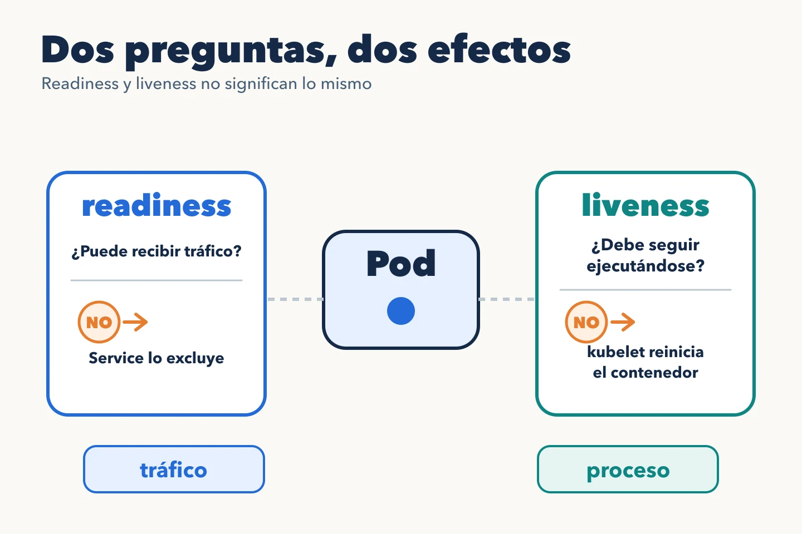

Una API puede tener el proceso vivo y no estar preparada para responder. Las
probes permiten expresar tres preguntas distintas al kubelet:

- **Startup:** ¿ha terminado de arrancar? Mientras no pase, se retrasan las
  comprobaciones de liveness y readiness.
- **Readiness:** ¿puede recibir tráfico ahora? Si falla, el Pod deja de ser
  un destino normal de los Services que lo seleccionan, pero el contenedor
  sigue ejecutándose.
- **Liveness:** ¿se ha quedado atascado de forma que reiniciarlo ayudaría?
  Si falla repetidamente, el kubelet reinicia el contenedor.



Las rutas del siguiente fragmento son ilustrativas: la aplicación tiene que
implementarlas y sus respuestas deben representar cada pregunta.

```yaml
startupProbe:
  httpGet: { path: /health/startup, port: 8080 }
  periodSeconds: 5
  failureThreshold: 24
readinessProbe:
  httpGet: { path: /health/ready, port: 8080 }
  periodSeconds: 5
  failureThreshold: 2
livenessProbe:
  httpGet: { path: /health/live, port: 8080 }
  periodSeconds: 10
  failureThreshold: 3
```

Este ejemplo concede hasta unos dos minutos al arranque antes de tratarlo
como fallido. Los umbrales reales deben basarse en el comportamiento medido
de la aplicación. Una readiness que consulta una base de datos puede ser
útil si ninguna petición funciona sin ella; una liveness que depende de esa
misma base puede convertir una caída externa en una oleada de reinicios.

## La prueba debe representar la pregunta

`/health/live` puede comprobar que el proceso responde y que su bucle
principal no está bloqueado. `/health/ready` puede exigir que inicializó
sus componentes críticos y puede atender su contrato. Evita que una
dependencia no esencial deje fuera del Service a una aplicación que todavía
puede ofrecer una respuesta útil.

Durante el apagado, readiness y terminación del Pod ayudan a retirar la
réplica del tráfico nuevo. La propagación de ese cambio no es instantánea:
la aplicación debe tratar `SIGTERM` y disponer de un plazo de gracia
suficiente para terminar peticiones en curso. Una probe correcta no sustituye
un apagado correcto.

La [documentación oficial de probes](https://kubernetes.io/docs/concepts/configuration/liveness-readiness-startup-probes/)
explica su comportamiento y sus efectos.
