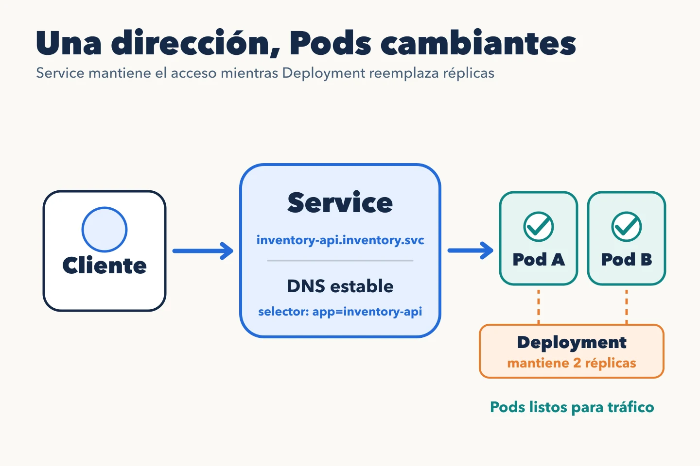

Los Pods de `inventory-api` se sustituyen al desplegar o al fallar un nodo.
Su IP no sirve como contrato para otra aplicación. Un **Service** da una
dirección estable y selecciona los Pods que pueden atenderla.



```yaml
apiVersion: v1
kind: Service
metadata:
  name: inventory-api
  namespace: inventory
spec:
  type: ClusterIP
  selector:
    app: inventory-api
  ports:
    - name: http
      port: 80
      targetPort: 8080
```

Un cliente del mismo namespace puede llamar a
`http://inventory-api:80/items`. Desde otro namespace puede usar
`inventory-api.inventory.svc.cluster.local`. El DNS resuelve el nombre del
Service; no entrega la lista de Pods para que la aplicación elija uno. La
infraestructura de red del clúster enruta la conexión a un backend elegible.

El selector `app: inventory-api` debe coincidir con las etiquetas de los
Pods. Kubernetes mantiene **EndpointSlices** con los destinos del Service y
sus condiciones. Si el Service existe pero no tiene endpoints listos,
comprobar etiquetas y readiness suele ser más útil que buscar un problema
de DNS.

```bash
kubectl -n inventory get service inventory-api
kubectl -n inventory get endpointslice -l kubernetes.io/service-name=inventory-api
kubectl -n inventory get pods -l app=inventory-api
```

Un Service `ClusterIP` da conectividad dentro del clúster. No publica por
sí mismo la API en Internet. Tampoco garantiza afinidad de sesión ni
reintentos seguros: una conexión puede romperse durante una sustitución.
La aplicación cliente necesita timeouts y una política de reintentos acorde
con la idempotencia de cada operación.

La [documentación de Services](https://kubernetes.io/docs/concepts/services-networking/service/)
y [EndpointSlices](https://kubernetes.io/docs/concepts/services-networking/endpoint-slices/)
detalla cómo se descubren y actualizan los destinos.
