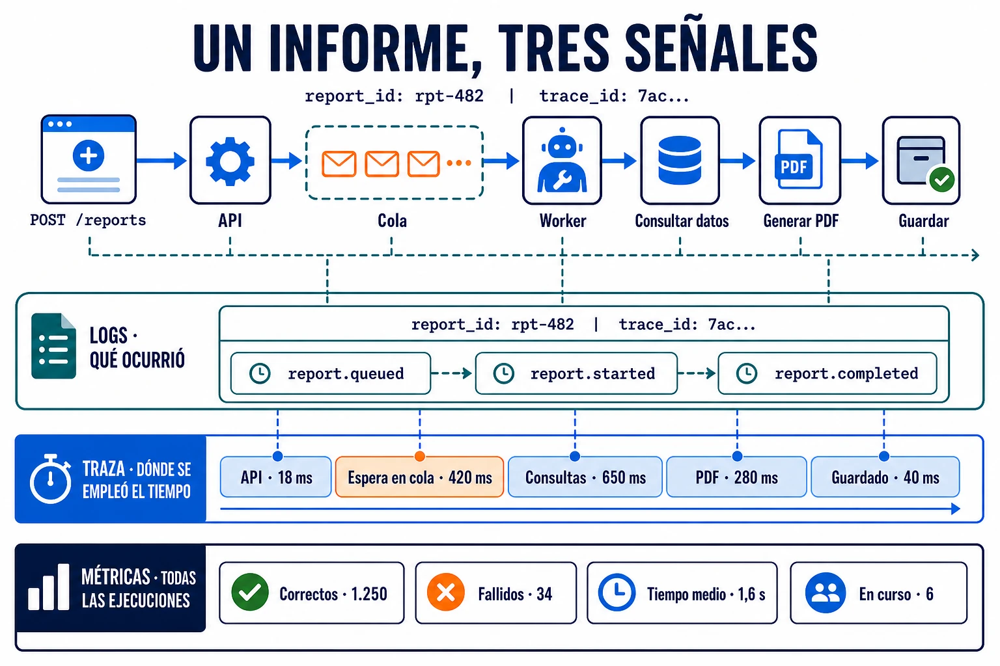

La observabilidad es la capacidad de **entender qué ocurre dentro de un sistema
a partir de la información que produce**. Permite conocer su estado, detectar
problemas e investigar por qué se comporta de una forma determinada.

## Cómo funciona

Una aplicación observable genera tres señales principales:

- **Logs:** registran eventos concretos, como un informe encolado o completado.
- **Métricas:** agregan medidas en el tiempo, como informes correctos, fallidos
  o el tiempo medio de generación.
- **Trazas:** muestran el recorrido de un informe desde la petición hasta el
  archivo guardado y cuánto tardó cada paso.

Las tres se complementan. Una métrica muestra que aumentó el tiempo de
generación, una traza señala si la espera estuvo en la cola o en una consulta y
los logs explican qué ocurrió con ese informe. Juntas permiten pasar de detectar
un síntoma a encontrar su causa.

## En sistemas distribuidos

En una aplicación sencilla, las tres señales proceden del mismo proceso: puedes
recopilar sus logs, consultar sus métricas y seguir la generación sin cruzar
varios servicios. En el ejemplo, la petición atraviesa una API, una cola, un
worker y las fuentes de datos; cada componente produce su propia parte de la
información.

Para observar el recorrido completo hay que centralizar las señales y propagar
un contexto común. El `report_id` identifica el informe y el `trace_id` conecta
su ejecución entre servicios. Al incluir ambos en los logs puedes relacionarlos
con la traza, aunque se hayan generado en procesos o máquinas diferentes.
