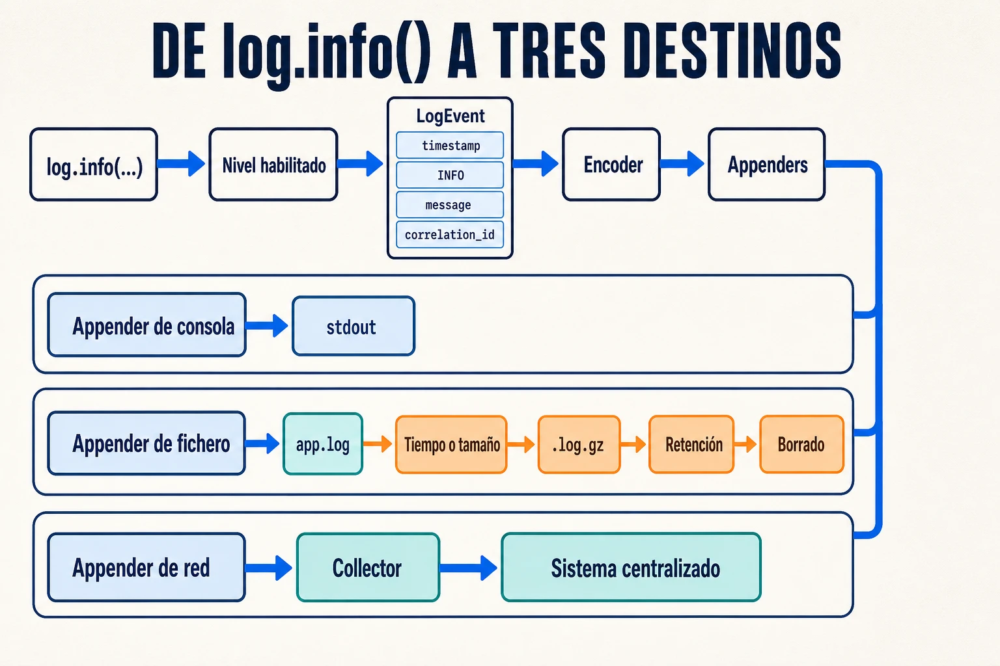

Una llamada como `log.info(...)` parece sencilla, pero puede terminar escribiendo
en consola, en un archivo o incluso enviando datos por red. Entre el código y el
destino hay una tubería que filtra, construye y distribuye cada evento.

## Qué ocurre al hacer log

El recorrido general es este:

```text
log.info(...) → comprobar nivel → construir evento → filtrar
              → codificar → enviar a uno o varios appenders
```

Si el nivel está desactivado, la llamada se descarta. Si está habilitado, el
logger crea un evento con el mensaje, el contexto y sus metadatos; el encoder lo
serializa y los **appenders** lo envían a sus destinos.

Un appender síncrono escribe desde el hilo actual. Uno asíncrono usa una cola,
pero, cuando se llena, debe bloquear la aplicación o descartar logs.

## Cómo llega a distintos destinos



Un appender decide dónde termina cada evento:

- **Consola**: escribe en `stdout` o `stderr`.
- **Fichero**: guarda los logs en disco y aplica políticas de rotación.
- **Red**: los envía mediante protocolos como Syslog o GELF. También es posible
  escribir en una base de datos, aunque no suele ser la primera opción.
- **Varios destinos**: cada uno añade serialización, entrada/salida y su propio
  modo de fallo. Un disco puede llenarse y una conexión de red puede bloquearse.

Logback es un ejemplo de implementación que permite declarar esa tubería en
`logback-spring.xml`:

```xml
<configuration>
  <appender name="STDOUT" class="ch.qos.logback.core.ConsoleAppender">
    <encoder>
      <pattern>%d %-5level [%X{correlation_id}] %logger - %msg%n</pattern>
    </encoder>
  </appender>

  <appender name="FILE" class="ch.qos.logback.core.rolling.RollingFileAppender">
    <file>logs/app.log</file>
    <rollingPolicy class="ch.qos.logback.core.rolling.SizeAndTimeBasedRollingPolicy">
      <fileNamePattern>logs/app.%d{yyyy-MM-dd}.%i.log.gz</fileNamePattern>
      <maxFileSize>100MB</maxFileSize>
      <maxHistory>14</maxHistory>
      <totalSizeCap>2GB</totalSizeCap>
    </rollingPolicy>
    <encoder>
      <pattern>%d %-5level [%X{correlation_id}] %logger - %msg%n</pattern>
    </encoder>
  </appender>

  <root level="INFO">
    <appender-ref ref="STDOUT" />
    <appender-ref ref="FILE" />
  </root>
</configuration>
```

En este ejemplo, el fichero activo es `logs/app.log`. Se archiva cada día o al
superar `100MB`, los archivos rotados se comprimen como `.log.gz` y se conservan
durante `14` días sin rebasar `2GB` en total. Son valores ilustrativos: deben
ajustarse al volumen y al espacio disponible. La rotación, la compresión, la
retención y el límite total protegen el disco; sin esas políticas, los logs
pueden degradar el servidor o detenerlo cuando el almacenamiento se agota.

Enviar directamente por red acopla la aplicación al sistema externo. Por eso es
habitual escribir en `stdout` o en un archivo y dejar que un collector lo envíe
a un sistema centralizado como Graylog o Loki.

Centralizar los logs resuelve dónde buscarlos, pero no cómo saber qué eventos
pertenecen a la misma operación. Para eso hace falta un identificador común.

## Cómo se correlacionan los logs

El **MDC** (*Mapped Diagnostic Context*) es un mapa de claves y valores asociado
al contexto actual. Permite guardar un `correlation_id` y añadirlo
automáticamente a cada evento mediante `%X{correlation_id}`:

```java
MDC.put("correlation_id", correlationId);
try {
  log.info("Report generation started report_id={}", reportId);
  generateReport(reportId);
} finally {
  MDC.remove("correlation_id");
}
```

El `finally` evita que un hilo reutilizado mezcle peticiones. Si la operación
continúa por HTTP, una cola o un hilo asíncrono, el `correlation_id` debe
propagarse e instalarse de nuevo: el MDC no cruza esos límites automáticamente.

El `report_id` identifica el informe; el `correlation_id`, la operación completa;
y el `trace_id`, una ejecución trazada.
